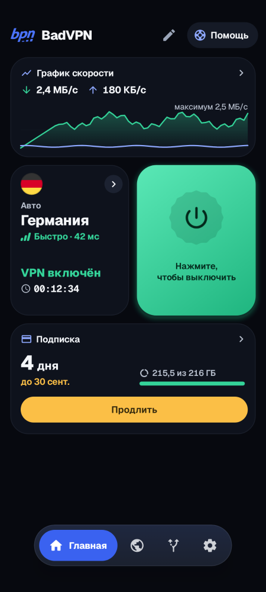
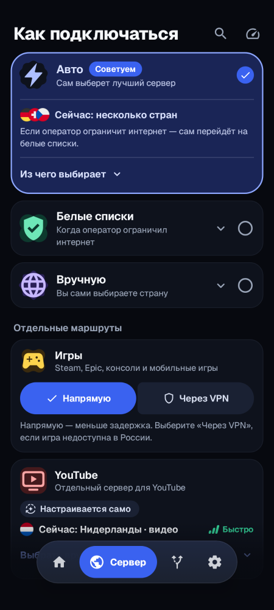
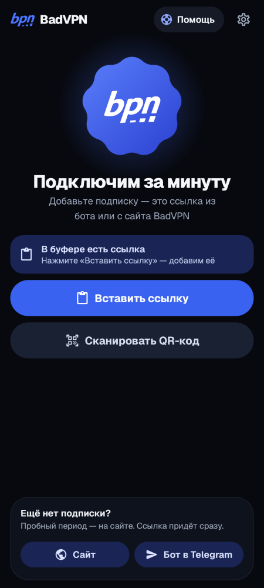
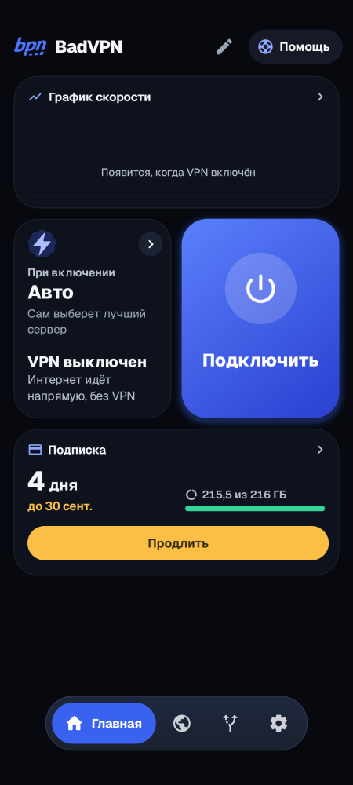
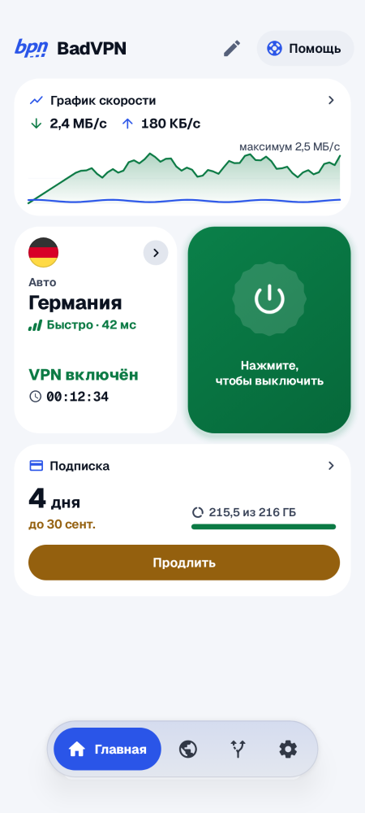
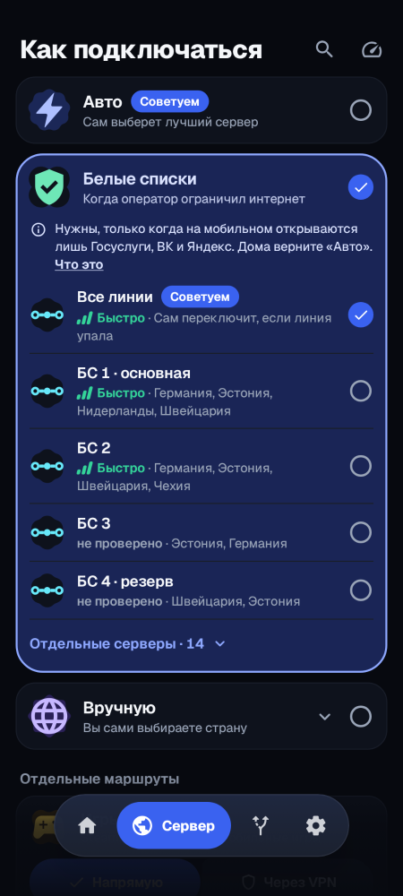
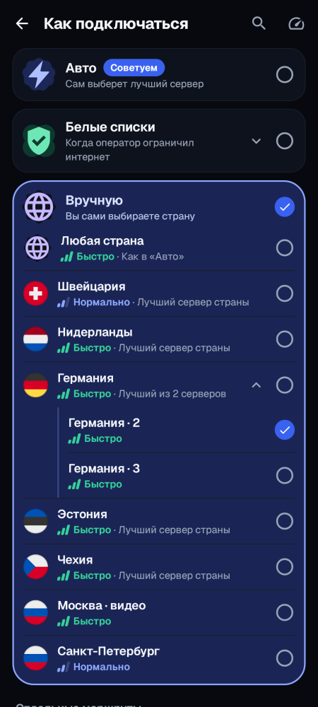
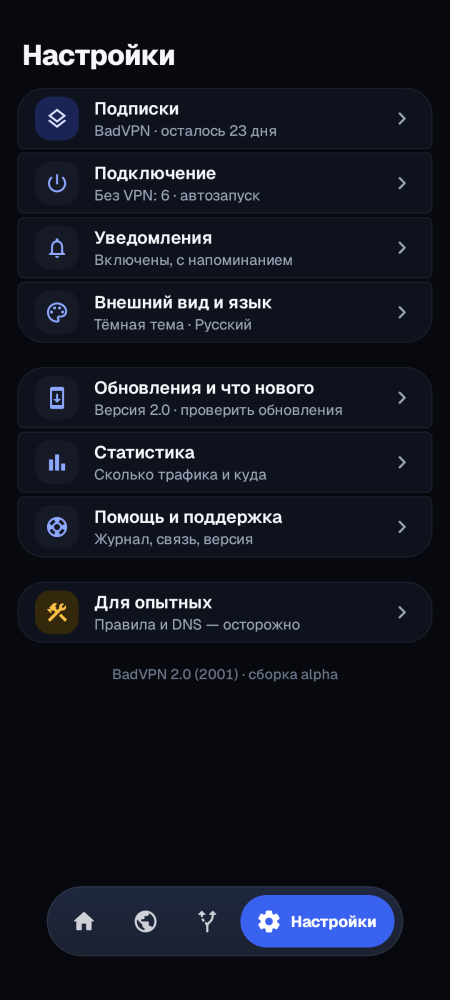
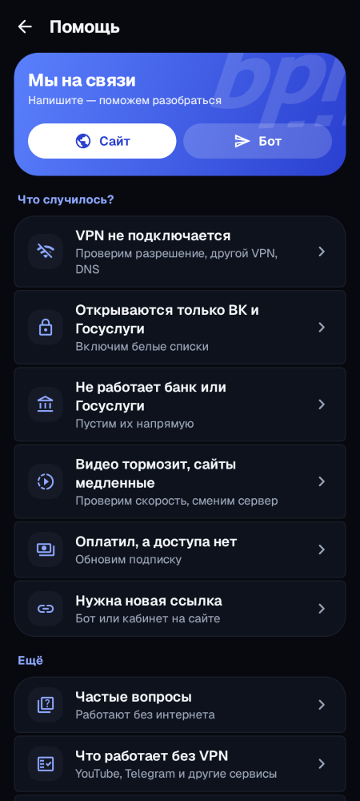

# BadVPN для Android

VPN-клиент сервиса BadVPN для Android 6.0 и новее.

Здесь только готовые APK, исходного кода в этом репозитории нет.

<p>



</p>

## Скачать

Последняя версия — на странице [Releases](https://github.com/Rerowros/bpn-android-releases/releases/latest).

| Файл | Для чего |
|---|---|
| `BadVPN_<версия>_arm64-v8a.apk` | почти все телефоны последних лет — берите его |
| `BadVPN_<версия>_armeabi-v7a.apk` | старые и недорогие телефоны с 32-битным процессором |
| `BadVPN_<версия>_universal.apk` | если не знаете, какой нужен: подходит всем, но весит больше |
| `BadVPN_<версия>_x86_64.apk`, `_x86.apk` | эмуляторы и редкие планшеты на Intel |

Дальше приложение обновляется само: новая версия приходит с нашего сервера `dl.badvpn.win`, APK отсюда нужен только для первой установки.

## Подписка

Подписку BadVPN можно получить в Telegram: https://t.me/bpn228bot?start=c_bpnclash или на сайте https://site.badvpn.win

После оплаты нажмите «Подключить в приложении» — подписка добавится сама. Можно и вставить ссылку на подписку или отсканировать QR-код.

## Скриншоты

| | | |
|---|---|---|
| <br>Главная — VPN включён | <br>Главная — VPN выключен | <br>Светлая тема |
| <br>Как подключаться | <br>Белые списки | <br>Выбор страны вручную |
| <br>Первый запуск | <br>Настройки | <br>Помощь |

Скриншоты сделаны на выдуманных данных.

## Проверка файла

SHA-256 каждого APK указан в описании релиза и в файле `SHA256SUMS.txt` рядом с ним. Проверить в PowerShell:

```powershell
Get-FileHash .\BadVPN_1.1.11_arm64-v8a.apk -Algorithm SHA256
```

Все версии подписаны одним ключом. SHA-256 сертификата подписи:

```
F2:E2:08:D1:2D:0D:C3:95:6C:95:63:4A:89:00:93:19:D8:D1:76:97:84:38:83:35:C0:C9:D6:4B:F3:3C:CE:0F
```

Android при установке сам сверяет подпись: обновление поверх установленной версии с другой подписью не встанет.

## Установка

1. Скачайте APK и откройте его.
2. Если Android спросит — разрешите установку из этого источника (браузера или файлового менеджера).
3. Откройте BadVPN, добавьте подписку и нажмите «Подключить».

## Основа

Приложение основано на [ClashMetaForAndroid](https://github.com/MetaCubeX/ClashMetaForAndroid) (GPL-3.0), ядро VPN — [mihomo](https://github.com/MetaCubeX/mihomo) (GPL-3.0).

## English

BadVPN is an Android 6.0+ VPN client for the BadVPN service. This repository hosts release APKs only; it contains no source code. Download the latest APK from [Releases](https://github.com/Rerowros/bpn-android-releases/releases/latest) — `arm64-v8a` fits almost every modern phone, `universal` fits all — and check its SHA-256 against `SHA256SUMS.txt`. The app updates itself afterwards. Built on ClashMetaForAndroid and the mihomo core (both GPL-3.0).
